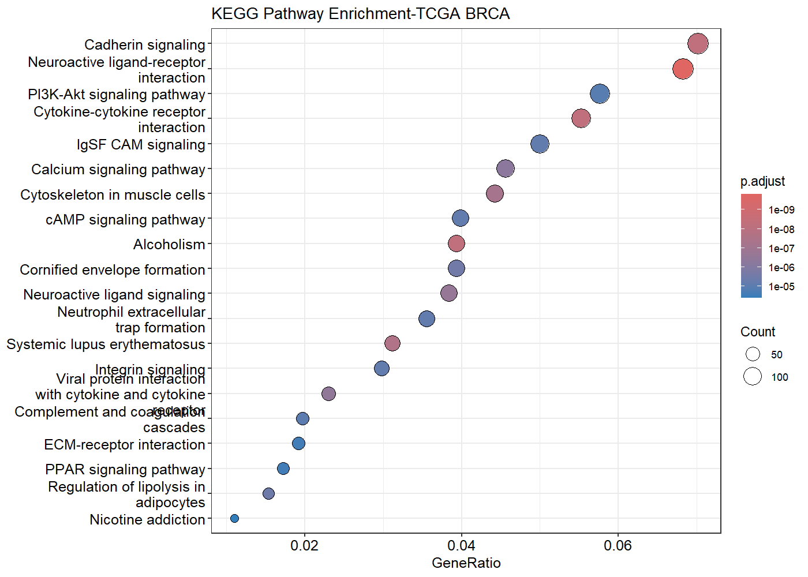

# TCGA-BRCA RNA-seq Differential Expression and Pathway Analysis

## Overview

This project presents a computational analysis of RNA-seq data from
The Cancer Genome Atlas Breast Invasive Carcinoma (TCGA-BRCA) project.

The objective was to identify differentially expressed genes between
Primary Tumor and Solid Tissue Normal samples and investigate their
associated biological processes and signaling pathways.

## Dataset

- Project: TCGA-BRCA
- Primary Tumor samples: 1111
- Solid Tissue Normal samples: 113
- Total samples: 1224

## Tools and Technologies

- R
- RStudio
- limma
- edgeR
- clusterProfiler
- org.Hs.eg.db
- pheatmap
- ggplot2
- enrichplot

## Analysis Workflow

1. RNA-seq count matrix preparation
2. Sample metadata preparation
3. Count filtering and normalization
4. Differential gene expression analysis
5. Identification of significant DEGs
6. Upregulated and downregulated gene analysis
7. Volcano plot visualization
8. Top-50 DEG heatmap
9. GO Biological Process enrichment
10. KEGG pathway enrichment
11. Pathway visualization

## Key Results

- Significant DEGs: 7,773
- Upregulated genes: 2,569
- Downregulated genes: 1
- Genes mapped to Entrez IDs: 5,777
- Enriched KEGG pathways: 64

## Visualizations

### Top 50 Differentially Expressed Genes


### GO Biological Process Enrichment


### KEGG Pathway Enrichment



## Key Biological Findings

Pathway enrichment identified multiple biologically relevant pathways,
including cytokine-cytokine receptor interaction, calcium signaling,
ECM-receptor interaction, cadherin-associated signaling and
neuroactive ligand-receptor interaction.

These enriched pathways provide potential biological context for the
molecular differences observed between tumor and normal breast tissue.

## Repository Structure

```text
TCGA-BRCA-RNAseq-Analysis/
├── scripts/
│ └── TCGA_BRCA_analysis.R
├── results/
├── figures/
└── docs/
